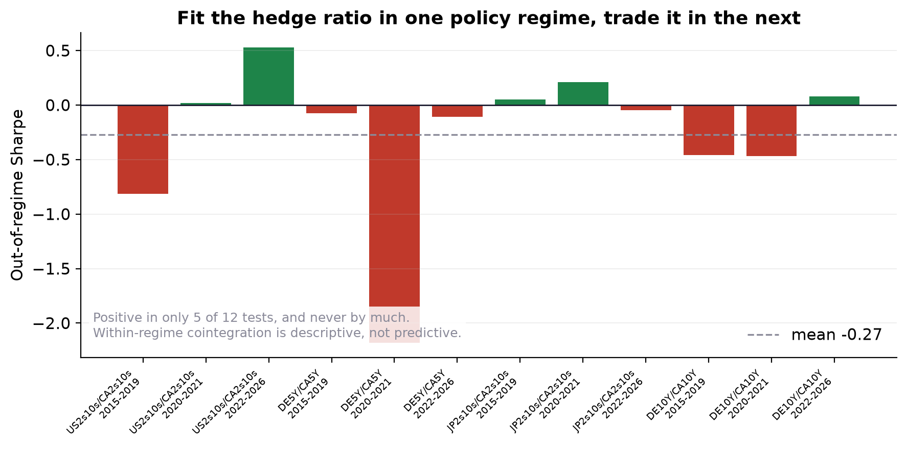
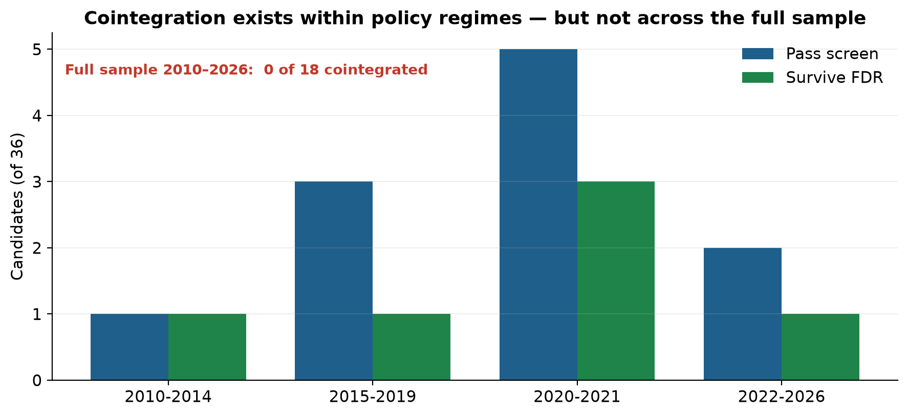
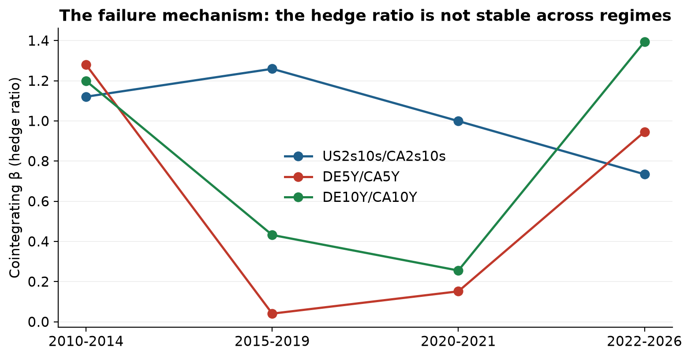
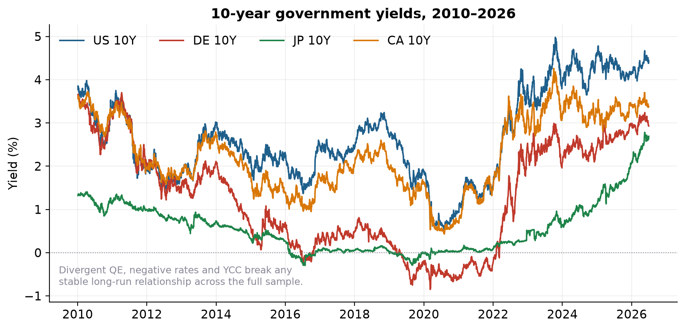

# Global Rates Relative Value

Cross-country government bond relative-value research: cointegration screening,
DV01-neutral pairs trading, and policy-regime analysis across the US, Germany,
Japan, and Canada.

**Status: in progress. Current result is negative — and that is the finding.**

---

## What this is

A test of a common idea: that government yield curves across developed markets are
tied by long-run equilibria you can trade when they diverge. The pipeline screens
every candidate pair for cointegration, trades survivors with a z-score state
machine, and — critically — checks whether relationships found in one monetary
policy regime survive into the next.

## The result so far

| Stage | Outcome |
|---|---|
| Full sample 2010–2026 | **0 of 18** candidates cointegrated |
| Within policy regimes | **11 of 144** pass; **6 survive FDR correction** |
| Fit one regime, trade the next | **mean Sharpe −0.27**, positive in 5 of 12 |





Cointegration *does* appear within individual policy regimes, with tradable
half-lives of 8–25 days among the FDR survivors. It does **not** persist out of
regime. The mechanism is visible in the data: the hedge ratio β for DE5Y/CA5Y is
fit at 1.28, then 0.04, then 0.15, then 0.95 across the four regimes. A position
sized in one regime is simply the wrong position in the next.



**Canada appears in 10 of 11 survivors** — the tighter US/Canada policy linkage
produces relationships the more divergent markets cannot.

FX contamination was measured explicitly: R² max 0.0016 against the relevant
currency pair, so the negative result is a **rates** finding, not a currency
artifact.

Full detail, including every failed candidate, in [FINDINGS.md](FINDINGS.md).

## Why the negative result is worth publishing

2010–2026 spans divergent QE programmes, the ECB's negative-rate era, the Bank of
Japan's yield-curve control, and desynchronised post-COVID hiking. A stable
long-run equilibrium between two curves is a strong assumption, and this period
violates it. "Cross-country yield spreads were not cointegrated out-of-regime over
2010–2026" is a defensible, reportable finding — presented with the full screen
table rather than a cherry-picked survivor.

The multiple-testing discipline earned its keep immediately. The regime grid
throws up 11 raw passes; FDR correction across all 144 tests cuts that to 6, and
the out-of-regime test then removes what is left. Nine of the 11 raw survivors
already lose money inside their own fitting window.

## Data

| Market | Source | Tenors |
|---|---|---|
| US | FRED constant maturity (`DGS2/5/10/30`) | 2Y 5Y 10Y 30Y |
| Germany | Bundesbank BBSIS (Svensson-fitted, daily) | 2Y 5Y 10Y 30Y |
| Japan | Japan MoF daily JGB curve | 2Y 5Y 10Y 30Y |
| Canada | Bank of Canada Valet API | 2Y 5Y 10Y 30Y |
| FX | ECB Data Portal + Bank of Canada | USD/EUR, USD/JPY, USD/CAD |

Every cached file is free, public, redistributable data. Nothing in this repository is
Bloomberg-derived — see the rebuild note below.



3,762 aligned daily observations, 2010-01-04 → 2026-06-30, no gaps. Cached in
`gr_rv/data/`, which is the default cache location, so the analysis runs offline from a
fresh clone with no configuration. Point `GRRV_CACHE` elsewhere to use another folder.

Caveats recorded in code: CA 30Y is BoC's generic "LONG" benchmark, not a fixed
30Y constant maturity; JP 2Y has 1,072 zero-change days (yield-curve control);
negative DE/JP yields are genuine. FRED publishes CMT yields to two decimal
places, which is coarser than the other three sources and is why US 2Y shows 783
zero-change days.

### Rebuilt 2026-08-23 on FRED US yields

The original run used a Bloomberg `USGG*` export for the US leg. That file is not
redistributable, so it has been removed and the US curve rebuilt from FRED
`DGS2/5/10/30`. The panel loses 67 rows (3,829 → 3,762) because FRED marks US
market holidays as missing where the Bloomberg series carried a value.

Every qualitative finding survives the rebuild; the numbers moved as follows.

| Result | Bloomberg US (original) | FRED US (current) |
|---|---|---|
| Full sample cointegrated | 0 of 18 | **0 of 18** |
| Regime-grid raw passes | 7 of 144 | **11 of 144** |
| Surviving FDR | 3 | **6** |
| Out-of-regime mean Sharpe | −0.32 | **−0.27** |
| Out-of-regime positive | 2 of 12 | **5 of 12** |
| Canada in survivors | 6 of 7 | **10 of 11** |
| FDR-survivor half-lives | 8–26 d | **8–25 d** |
| FX contamination R² max | 0.0020 | **0.0016** |

The direction of the result is unchanged: nothing is cointegrated over the full
sample, cointegration appears only inside policy regimes, and it does not survive
into the next regime. The screen is somewhat more permissive on FRED data — 11 raw
passes rather than 7 — which is consistent with the coarser two-decimal rounding
producing flatter, more stationary-looking residuals, and is a reason to read the
raw-pass count as an upper bound.

## Layout

```
ratslib/          shared research core (also used by the Treasury project)
  io              loaders: Bloomberg CSV quirks + free fetchers (FRED, Bundesbank,
                  Japan MoF, Bank of Canada, ECB) with rate-limit backoff
  calendar        master-calendar alignment
  futures         continuous series, DV01 hedge ratios, synthetic bond returns
  backtest        periodic + event-driven pairs engines, walk-forward splits
  metrics         Sharpe, Sortino, Calmar, drawdown, turnover, hit rate
  stats           HAC Diebold–Mariano, ADF, KPSS, Engle–Granger, half-life,
                  Johansen, Benjamini–Hochberg FDR

gr_rv/
  data_mvp        acquisition, caching, coverage report
  strategy_mvp    candidate universe, cointegration screen, pairs backtest
  subperiod       policy-regime windows, grid screen, fit-one-regime/trade-next
  fx_layer        hedged vs unhedged conventions, contamination test

scripts/
  make_figures.py redraws the four figures in results/ from the committed cache
```

## Usage

```python
from gr_rv import data_mvp as D, strategy_mvp as S, subperiod as SP

bundle = D.load_all(start="2010-01-01")
panel  = bundle["yields"]

grid = SP.subperiod_screen(panel)                    # FDR across the whole grid
print(SP.stability_report(grid))
print(SP.backtest_subperiod_survivors(panel, grid))  # in-period, for reference only

# the decisive test. window=126 is the z-score lookback the published
# out-of-regime numbers were computed with; the module default is 252.
universe = S.candidate_universe(markets=("US", "DE", "JP", "CA"))
SP.forward_test_survivor(panel, universe[0], "2020-2021 COVID",
                         "2022-2026 hiking/normalis.", window=126)
```

Everything in `subperiod` defaults to the four-market universe
(`subperiod.MARKETS`), which is the one the published grid uses, so no `universe=`
argument is needed for the standard workflow. Pass one only to screen a different
set — the grid and the backtest must then agree, and a mismatch raises a readable
`ValueError`.

The `window=126` choice matters and is not a detail: at the module default of 252 the
same twelve tests give a mean out-of-regime Sharpe of −0.17 rather than −0.27, because
the longer lookback cuts the trade count. That sensitivity is itself part of the
finding — see the parameter-fragility discussion in [FINDINGS.md](FINDINGS.md).

Redraw every figure in `results/` from the committed cache with:

```bash
python scripts/make_figures.py
```

It runs the same screen, grid and forward test as above, so the figures cannot drift
from the numbers in this README.

## Validation

The cointegration screen is tested against synthetic data with known answers: it
recovers a constructed cointegrated pair (β̂ 1.99 vs true 2.00, half-life 16.9
days, ADF p < 0.0001) and correctly rejects two independent random walks. The
shared core reproduces the Treasury project's published results.

## Open work

1. **UK gilt yields** — Germany/UK is the last untested high-prior pair. The Bank
   of England endpoint returns HTML for the series codes tried; see
   [DATA_PULL_REQUEST.md](DATA_PULL_REQUEST.md).
2. **Time-varying β (Kalman)** — β instability across regimes is the *identified*
   failure mechanism, making this the theoretically motivated next step rather
   than a fishing expedition.
3. Pre-registered shorter estimation windows; then HMM regimes, futures returns,
   credit.

## Related

[`treasury-curve-carry-momentum`](https://github.com/Nicholashsw/treasury-curve-carry-momentum) — the
single-curve US study this infrastructure was extracted from.
